<p><picture><source media="(prefers-color-scheme: dark)" srcset="assets/banner-dark.webp"><source media="(prefers-color-scheme: light)" srcset="assets/banner-light.webp">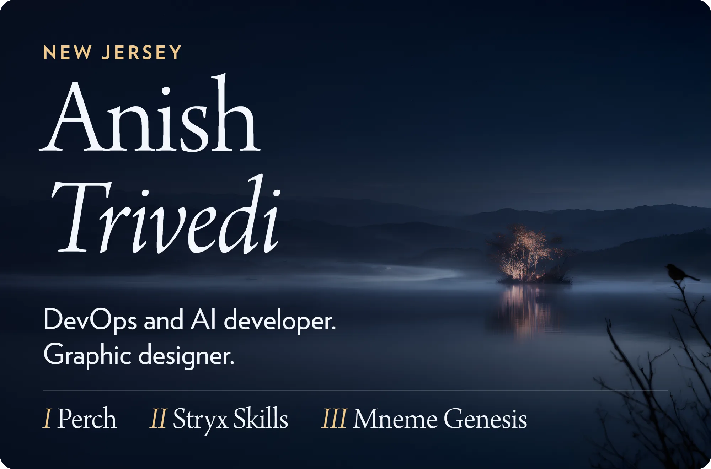</picture></p>

<p align="center"><a href="#perch"><b>Perch</b></a> &nbsp;·&nbsp; <a href="#stryx"><b>Stryx Skills</b></a> &nbsp;·&nbsp; <a href="#mneme"><b>Mneme</b></a> &nbsp;·&nbsp; <a href="#workshop">The workshop</a> &nbsp;·&nbsp; <a href="#try">Try one</a></p>

I build the software you look at all day, and the AI tools that run on your own machine. I write the code, run the servers and draw the pictures, so the thing you install and the page that sold it to you come from the same hands. Three of those things are below. All three are free to use.

<a name="perch"></a>

<h3><picture><source media="(prefers-color-scheme: dark)" srcset="assets/ch1-dark.webp"><source media="(prefers-color-scheme: light)" srcset="assets/ch1-light.webp">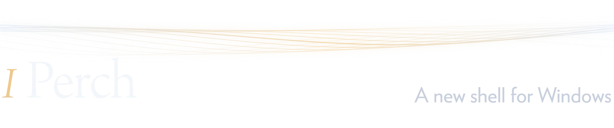</picture></h3>

<p><a href="https://omanishay-cyber.github.io/perch/"><picture><source media="(prefers-color-scheme: dark)" srcset="assets/perch-cover-dark.webp"><source media="(prefers-color-scheme: light)" srcset="assets/perch-cover-light.webp">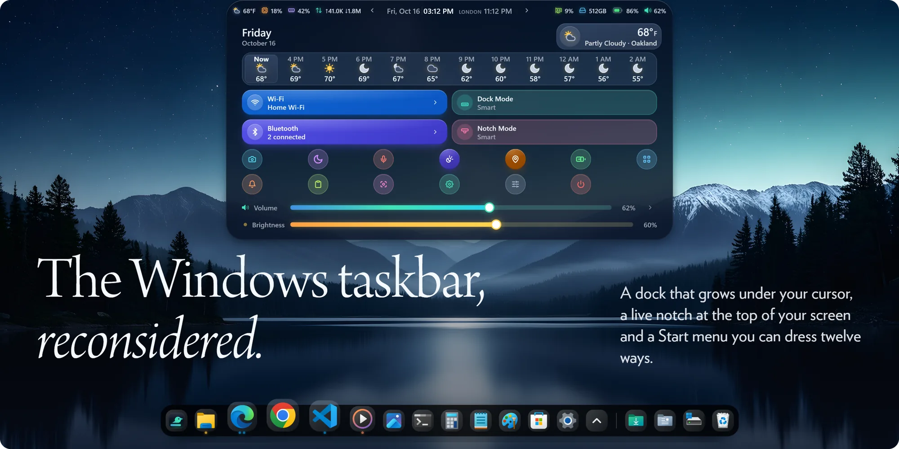</picture></a></p>

**You look at the same strip of icons all day. Perch makes it worth looking at.** The taskbar becomes a dock whose icons grow under your pointer. The empty top of your screen becomes a notch with the time, the weather, your music and how your PC is doing. The Start button opens a menu you pick from twelve designs. Your apps, files and settings stay exactly where they are, and if you ever remove Perch the Windows taskbar comes straight back.

<p><picture><source media="(prefers-color-scheme: dark)" srcset="assets/perch-nums-dark.webp"><source media="(prefers-color-scheme: light)" srcset="assets/perch-nums-light.webp">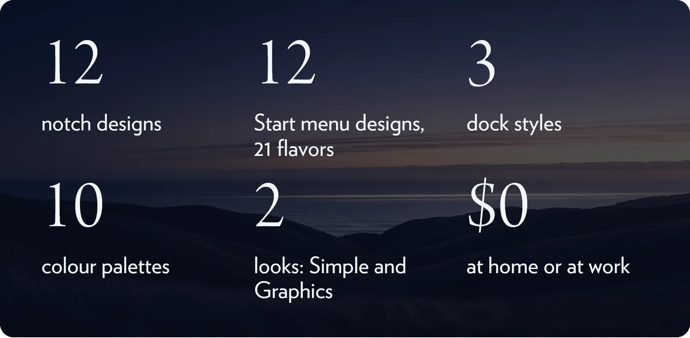</picture></p>

<p><a href="https://omanishay-cyber.github.io/perch/">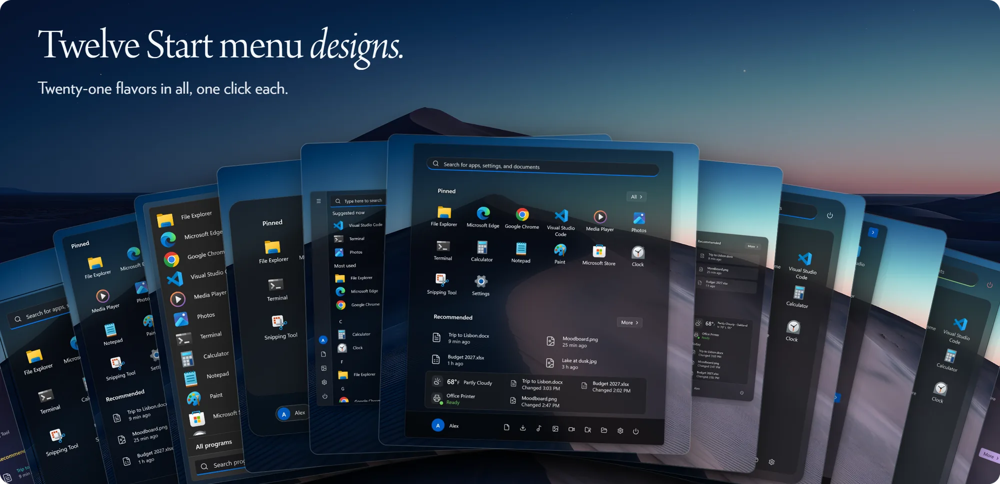</a></p>

**A Start menu that does more than start things.** Type `12*7` and the answer is the top result. Type `10 km to mi` and it converts. It finds Windows Settings pages by the words people actually use, works as a Run box, and learns which apps you open at this hour.

<p><a href="https://omanishay-cyber.github.io/perch/"><picture><source media="(prefers-color-scheme: dark)" srcset="assets/perch-notch-dark.webp"><source media="(prefers-color-scheme: light)" srcset="assets/perch-notch-light.webp">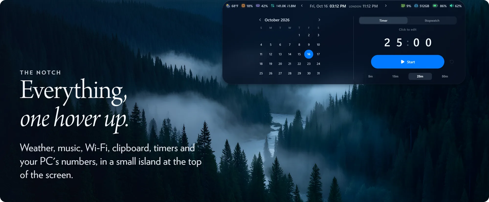</picture></a></p>

**A notch with a job.** Twelve live numbers from CPU to battery, a full music player with five visualizers and live lyrics, Wi-Fi and Bluetooth without opening Settings, a volume for every app, a clipboard you can read, a shelf for your files. It steps aside over full-screen games and can leave a tiny CPU, GPU and RAM strip instead.

<p><a href="https://omanishay-cyber.github.io/perch/"><picture><source media="(prefers-color-scheme: dark)" srcset="assets/perch-dock-dark.webp"><source media="(prefers-color-scheme: light)" srcset="assets/perch-dock-light.webp">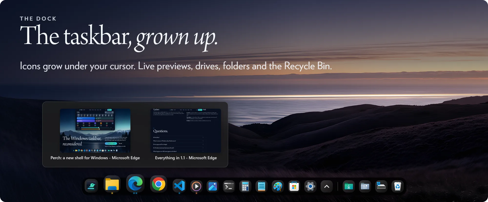</picture></a></p>

<p><picture><source media="(prefers-color-scheme: dark)" srcset="assets/perch-mosaic-dark.webp"><source media="(prefers-color-scheme: light)" srcset="assets/perch-mosaic-light.webp">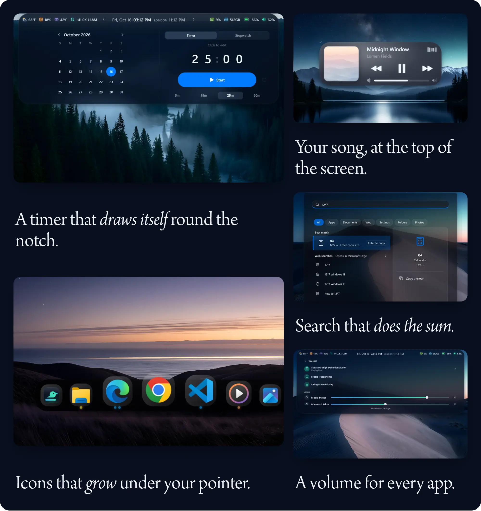</picture></p>

<details><summary><b>Everything else in the box</b></summary>

<ul><li><b>Privacy dots:</b> orange while an app uses the microphone, green for the camera. Point at one to see which app.</li><li><b>Power menu with a safety catch:</b> Restart and Shut down ask for a second click.</li><li><b>Dock extras:</b> drives, special folders, any folder you add, the Recycle Bin, Win+1 to Win+9, unread badges.</li><li><b>Start menu:</b> jump lists, pinned folders, a letter grid, a widgets strip, full keyboard control.</li><li><b>Looks:</b> your own colour, five spring feels, light and dark that follow Windows.</li><li><b>Updates:</b> signed. Perch refuses any update whose signature does not match. Turn Auto update off and nothing changes without you.</li><li><b>Runs on:</b> Windows 11 and Windows 10 version 22H2, on every screen size and scaling level, touch screens too.</li></ul>

</details>

<p><a href="https://github.com/omanishay-cyber/perch/releases/latest/download/Perch-Setup.exe">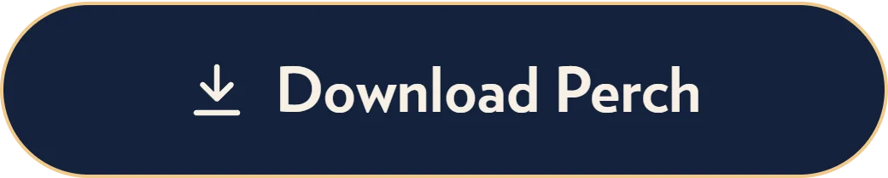</a></p>

[Website](https://omanishay-cyber.github.io/perch/) &nbsp;·&nbsp; [Repository and release notes](https://github.com/omanishay-cyber/perch) &nbsp;·&nbsp; Free, at home or at work

<a name="stryx"></a>

<h3><picture><source media="(prefers-color-scheme: dark)" srcset="assets/ch2-dark.webp"><source media="(prefers-color-scheme: light)" srcset="assets/ch2-light.webp"></picture></h3>

<p><a href="https://skills.stryxlabs.com/"><picture><source media="(prefers-color-scheme: dark)" srcset="assets/stryx-hero-dark.webp"><source media="(prefers-color-scheme: light)" srcset="assets/stryx-hero-light.webp">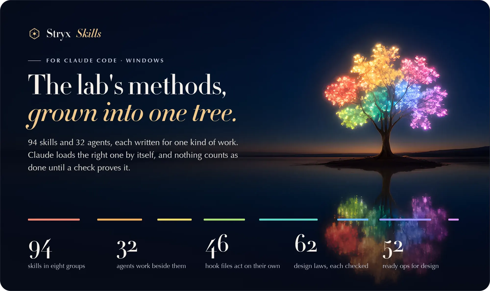</picture></a></p>

**An AI coder is only as good as its habits.** Left alone it works from memory, skips the check and tells you it is done. Stryx Skills gives Claude Code 94 skills and 32 agents, each written for one kind of work. A router reads your request and loads the right ones before Claude starts, and nothing counts as done until a check proves it.

<p><picture><source media="(prefers-color-scheme: dark)" srcset="assets/stryx-f1-dark.webp"><source media="(prefers-color-scheme: light)" srcset="assets/stryx-f1-light.webp">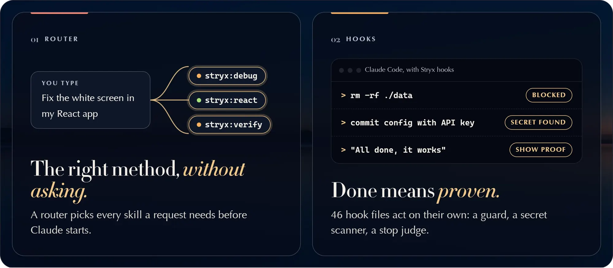</picture></p>

<p><picture><source media="(prefers-color-scheme: dark)" srcset="assets/stryx-f2-dark.webp"><source media="(prefers-color-scheme: light)" srcset="assets/stryx-f2-light.webp">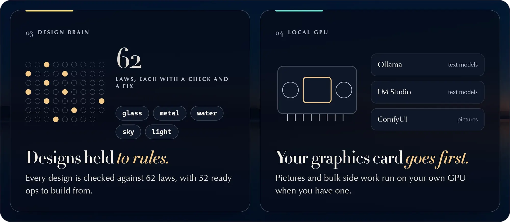</picture></p>

<p><picture><source media="(prefers-color-scheme: dark)" srcset="assets/stryx-f3-dark.webp"><source media="(prefers-color-scheme: light)" srcset="assets/stryx-f3-light.webp">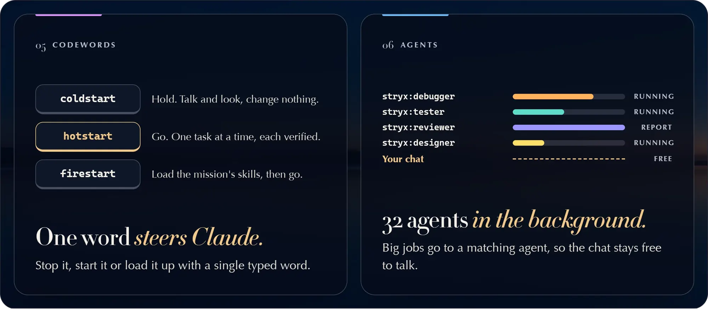</picture></p>

<p><picture><source media="(prefers-color-scheme: dark)" srcset="assets/stryx-flow-dark.webp"><source media="(prefers-color-scheme: light)" srcset="assets/stryx-flow-light.webp">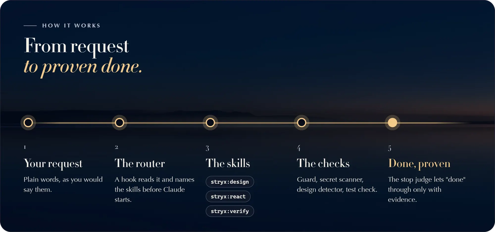</picture></p>

<details><summary><b>Without it, and with it</b></summary>

<ul><li><b>Without:</b> you name the method each time. <b>With:</b> the router loads the matching skills before Claude starts.</li><li><b>Without:</b> "done" means Claude said so. <b>With:</b> the stop judge wants test output, a type check or a screenshot.</li><li><b>Without:</b> one wrong command can delete a folder. <b>With:</b> the guard blocks it before it runs.</li><li><b>Without:</b> a key can slip into a commit. <b>With:</b> the secret scanner looks for keys and passwords.</li><li><b>Without:</b> designs drift to the same generic look. <b>With:</b> 62 laws, 52 ops and a design detector.</li><li><b>Without:</b> a long job blocks the chat. <b>With:</b> 32 agents take big jobs in the background.</li></ul>

</details>

```powershell
irm https://skills.stryxlabs.com/install.ps1 | iex
```

<p><a href="https://skills.stryxlabs.com/">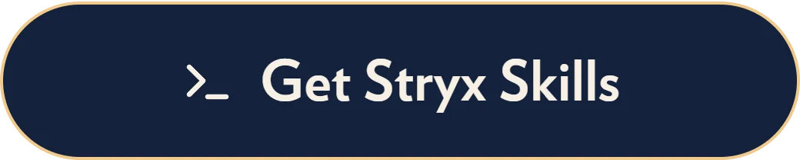</a></p>

[Product page](https://skills.stryxlabs.com/) &nbsp;·&nbsp; [GitHub page](https://omanishay-cyber.github.io/stryx-skills/) &nbsp;·&nbsp; [Repository](https://github.com/omanishay-cyber/stryx-skills) &nbsp;·&nbsp; [Stryx Labs](https://stryxlabs.com) &nbsp;·&nbsp; Windows. No fee, no subscription, no key, no sign-up.

<a name="mneme"></a>

<h3><picture><source media="(prefers-color-scheme: dark)" srcset="assets/ch3-dark.webp"><source media="(prefers-color-scheme: light)" srcset="assets/ch3-light.webp"></picture></h3>

<p><a href="https://mneme.stryxlabs.com"><picture><source media="(prefers-color-scheme: dark)" srcset="assets/mneme-cover-dark.webp"><source media="(prefers-color-scheme: light)" srcset="assets/mneme-cover-light.webp">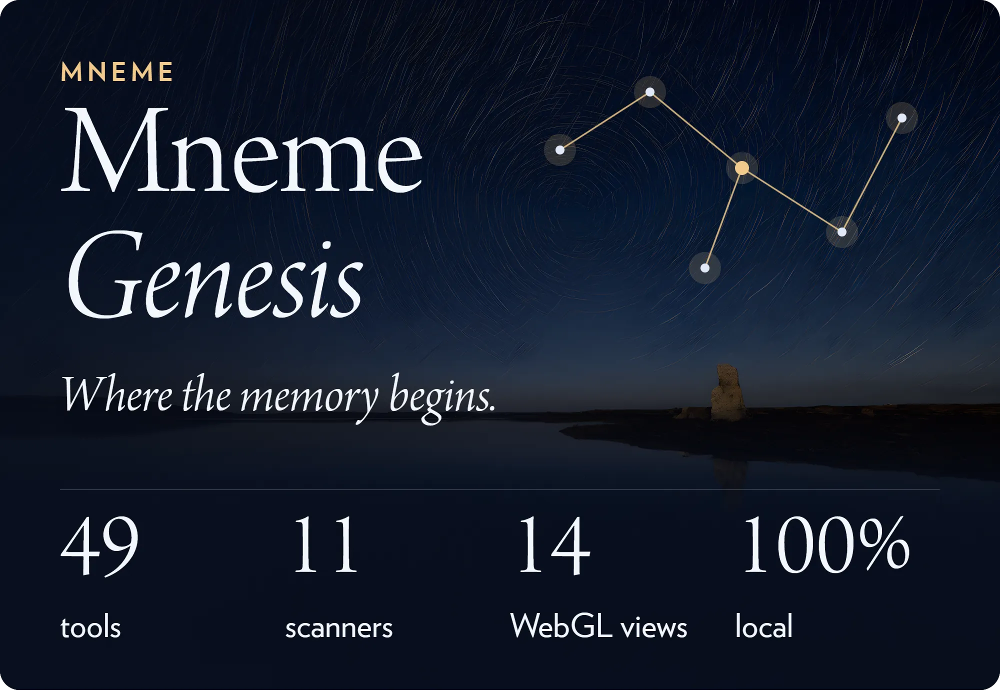</picture></a></p>

**Your AI forgets your project every time the chat ends. Mneme keeps it.** Mneme is a local memory and code graph for AI coding tools. It keeps the graph current as you save and holds what was learned on your own disk, so the next session starts where the last one stopped.

<p><picture><source media="(prefers-color-scheme: dark)" srcset="assets/mneme-cold-dark.webp"><source media="(prefers-color-scheme: light)" srcset="assets/mneme-cold-light.webp">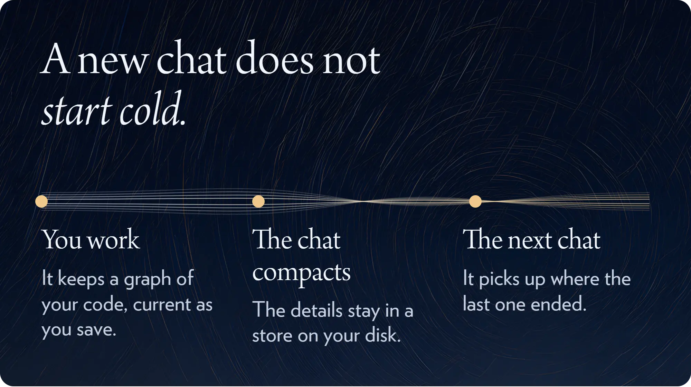</picture></p>

<p><picture><source media="(prefers-color-scheme: dark)" srcset="assets/mneme-ask-dark.webp"><source media="(prefers-color-scheme: light)" srcset="assets/mneme-ask-light.webp">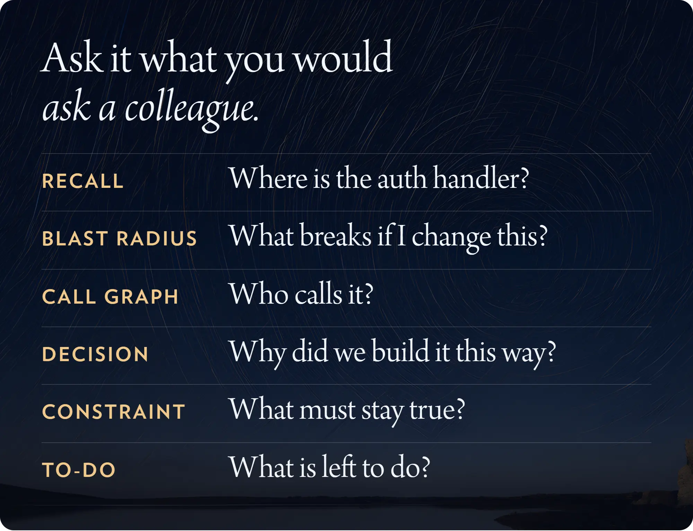</picture></p>

```bash
# macOS and Linux
curl -fsSL https://stryxlabs.com/install.sh | bash
```

```powershell
# Windows (PowerShell)
iex (iwr https://stryxlabs.com/install.ps1).Content
```

Both scripts detect your platform, verify SHA-256 checksums and install to `~/.mneme`. Free on your own code, personal or commercial. The source is closed.

<p><a href="https://mneme.stryxlabs.com">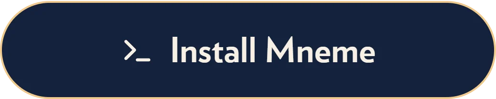</a></p>

[Docs and install guide](https://mneme.stryxlabs.com) &nbsp;·&nbsp; [Repository](https://github.com/omanishay-cyber/mneme)

<a name="workshop"></a>

<h3><picture><source media="(prefers-color-scheme: dark)" srcset="assets/ch4-dark.webp"><source media="(prefers-color-scheme: light)" srcset="assets/ch4-light.webp"></picture></h3>

<p><picture><source media="(prefers-color-scheme: dark)" srcset="assets/craft-dark.webp"><source media="(prefers-color-scheme: light)" srcset="assets/craft-light.webp">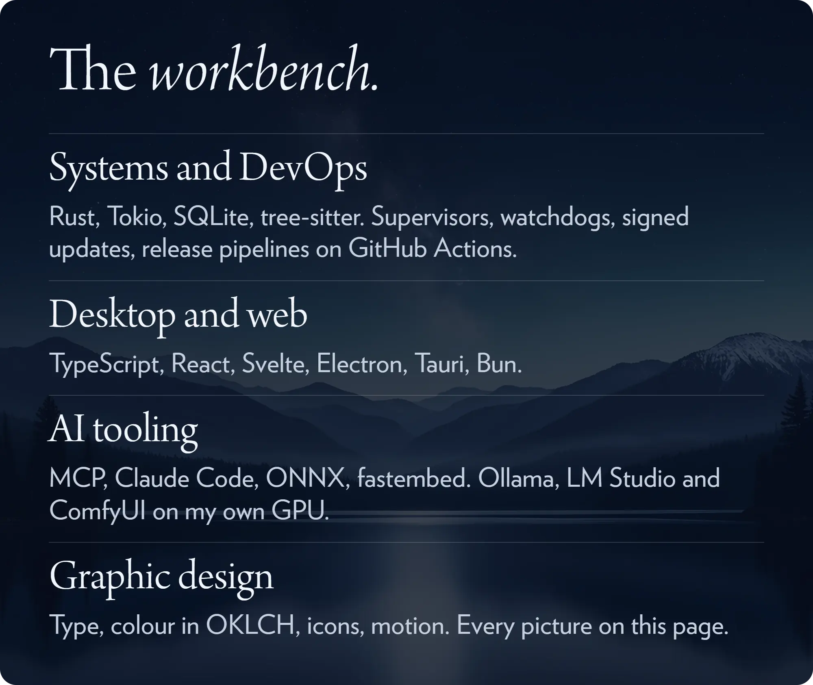</picture></p>

**What I believe about software**

1. Start from the user's pain, not from the tech stack. Every feature should answer a problem you can say in one sentence.
2. Stay local-first until you have a reason not to.
3. An AI forgetting your project is an architecture problem, not a prompt problem. Store the memory outside the chat.
4. Write the README before the code. If you can't explain it plainly, it isn't designed yet.
5. Ship small and often. Something people use today beats a perfect plan that never ships.

<a name="try"></a>

<h3><picture><source media="(prefers-color-scheme: dark)" srcset="assets/ch5-dark.webp"><source media="(prefers-color-scheme: light)" srcset="assets/ch5-light.webp"></picture></h3>

<p><picture><source media="(prefers-color-scheme: dark)" srcset="assets/closing-dark.webp"><source media="(prefers-color-scheme: light)" srcset="assets/closing-light.webp">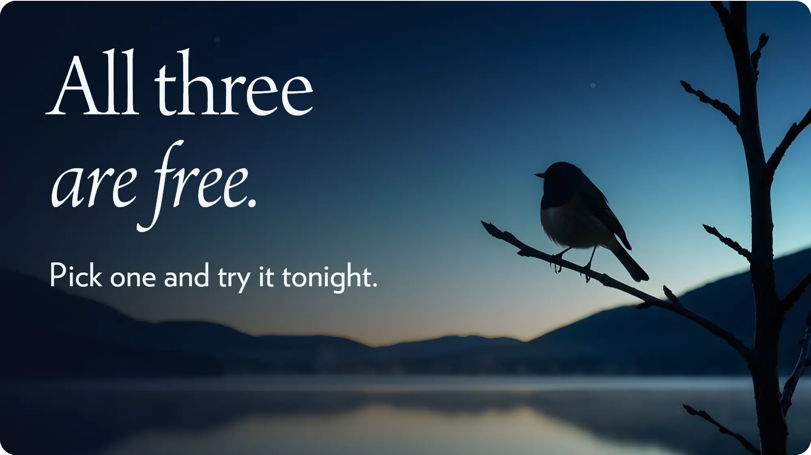</picture></p>

<p align="center"><a href="https://github.com/omanishay-cyber/perch/releases/latest/download/Perch-Setup.exe"></a> <a href="https://skills.stryxlabs.com/"></a> <a href="https://mneme.stryxlabs.com"></a></p>

Want to talk about local-first AI tools, MCP servers, Claude Code or desktop app design? Write to [hello@stryxlabs.com](mailto:hello@stryxlabs.com), or see the rest of the lab at [stryxlabs.com](https://stryxlabs.com).

<sub>New Jersey, USA · BS in Computer Science · The paintings on this page came from a model on my own GPU. The screens are the real apps with made-up data.</sub>
